# 标签页生命周期全自动接管与自主管理、滚动/长截屏自愈与图片压缩防爆设计文档

**文档标识**：`2026-11-15-bsk-tab-lifecycle-and-resilience-design`  
**作者**：Antigravity  
**状态**：待用户审批 (Pending Approval)  
**涉及模块**：
- `astrbot_plugin_bsk_browser/bsk/service.py`
- `astrbot_plugin_bsk_browser/bsk/shots.py`
- `astrbot_plugin_bsk_browser/main.py`
- `astrbot_plugin_bsk_browser/bsk/tools.py`
- `astrbot_plugin_bsk_browser/skill/bsk-browser/SKILL.md`
- `astrbot_plugin_bsk_browser/skill/browse-baidu.com/SKILL.md`
- `astrbot_plugin_bsk_browser/skill/browse-cn.bing.com/SKILL.md`
- `astrbot_plugin_bsk_browser/tests/`

---

## 1. 背景与核心问题定义 (Intent & Why)

在最近的线上实际运行日志（`astrbot-diagnostics-20261115-103504.zip` 及后续追加的实时日志）中暴露了 4 个直接破坏用户体验的核心缺陷：

### 1.1 点击触发新标签页机器人无感知，陷入重复点击死循环
- **现象**：在百度等页面点击搜索条目时，链接带 `target="_blank"` 在浏览器中新建了 Tab。但 `bsk` 的 Session Active Tab 仍保留在原搜索页。
- **死循环**：机器人执行 `sync` 时看到的依然是百度搜索页，误以为点击未生效（`"页面似乎没跳转成功，让我再试一次"`），重复点击生成了越来越多孤立 Tab。
- **用户诉求**：机器人起码得知道它的操作打开了一个新的 tab，并且能自主感知和清理。

### 1.2 标签页永久残留宿主机桌面（BrowserSkill 保护陷阱）
- **现象**：新 Tab 在会话关闭或任务完成后永远留在宿主机桌面，直到用户手动点击关闭。
- **机制**：BrowserSkill 扩展内部（`task-popups.ts`）将点击弹出的 Tab 归类为 `observedTabs`。在调用 `bsk session stop` 时，BrowserSkill 会判定这些标签页是“用户需要保留的标签页”，从而触发 `dropOnly: true`（只脱离托管，坚决不关闭窗口和标签页）！
- **用户诉求**：插件底层必须自动跟踪并接管生命周期清理，保证会话结束或不再需要时 100% 可靠清理，不再残留到用户主机。

### 1.3 页面滚动（wheel）与长截图遭遇 `observation_changed` 拦截报错
- **现象**：机器人执行 `bsk_interact(action="wheel")` 试图向下滚动到底部时，报错：`页面交互失败：操作被浏览器权限策略拒绝（原因：observation_changed）。（The strict observation changed before this action）`。
- **机制**：
  1. 此前的 `click` 等交互改变了页面 DOM，但插件未能清空 `_session_observations` 缓存；
  2. 后续调用无目标 `wheel` 或长截图 `full_page=True` 时，插件将已失效的旧 `observation_id` 拼入命令；
  3. `bsk` 权限策略拒绝执行（`reason: "observation_changed"`）；
  4. `service.interact` 和 `service.screenshot_ex` 的重试自愈白名单中只包含了 `("cooperation_sync_required", "observation_required", "control_context_invalid")`，**遗漏了 `observation_changed`**，导致报错直接抛给模型和用户。

### 1.4 截图/长截图在 QQ 中显示 `[图片]` 却为空白破图
- **现象**：QQ 客户端能收到 `[图片]` 消息提示，但内容破图或无法显示。
- **机制**：运行在 Docker 内的 AstrBot 通过 `aiocqhttp` 发送本地图片时，先将文件转为 Base64 字符串（体积增加 33%）。普通视口截图为 3~5MB PNG，长截图可达 10~30MB PNG，直接击穿 WebSocket / OneBot (NapCat) 默认的 **4MB 单帧通信阈值**，导致传输流被截断，协议端仅记录图片头而图像数据丢失。

---

## 2. 架构设计与解决方案 (Detailed Design)

```mermaid
flowchart TD
    subgraph S1["1. 交互与新Tab自动感知"]
        Click["bsk_interact(action='click')"] --> ExecClick["底层执行 click"]
        ExecClick --> InvalidateObs["立即清除失效的 _session_observations"]
        ExecClick --> CheckTabs["查询 Agent Window 标签页列表"]
        CheckTabs --> DiffTabs{"是否发现新增 Tab?"}
        DiffTabs -- "是" --> AutoSelect["自动执行 bsk tab select <new_id>"]
        AutoSelect --> RecordTab["纳入 Session 活跃标签管理"]
        AutoSelect --> NotifyModel["返回结果中注入明确提示:\n【检测到新标签页并已自动切换焦点】\n提示模型阅读后可自主 close"]
        DiffTabs -- "否" --> ReturnNormal["正常返回交互结果"]
    end

    subgraph S2["2. 令牌失效自愈机制"]
        Action["wheel / screenshot_ex(full_page=True)"] --> ExecAction["执行动作"]
        ExecAction --> CheckErr{"是否报错 observation_changed?"}
        CheckErr -- "是" --> AutoSync["自动触发 sync_session 刷新 observation ID"]
        AutoSync --> RetryAction["携带新令牌自动重试动作"]
        CheckErr -- "否" --> ActionDone["动作成功"]
    end

    subgraph S3["3. 截图/长截图安全压缩流水线"]
        RawShot["bsk 生成原始 PNG (视口/超长全页)"] --> CompressProc["Pillow 智能自适应压缩"]
        CompressProc --> OptJPEG["转为高质量 JPEG (q=85) + 宽长自适应钳位"]
        OptJPEG --> CheckSize["文件体积稳定在 500KB~1.5MB 安全区"]
        CheckSize --> SendQQ["event.image_result 发送压缩图 (杜绝破图)"]
    end

    subgraph S4["4. 会话结束与垃圾回收彻底扫尾"]
        CloseCmd["bsk_session(action='close') / 超时回收 / 插件卸载"] --> ScanAgentTabs["查询 Agent Window 所有剩余 Tab"]
        ScanAgentTabs --> CloseEachTab["主动循环执行 bsk tab close <id>"]
        CloseEachTab --> ClearObserved["清空 BrowserSkill observedTabs 保护计数"]
        ClearObserved --> StopSession["调用 bsk session stop 关闭窗口"]
        StopSession --> ZeroLeak["宿主机 0 残留"]
    end
```



### 2.1 模块一：Tab 自动跟踪、接管焦点与机器人自主清理

#### 2.1.1 自动 Tab Diffing 与焦点切换（底层兜底）
- 在 `service.interact`（尤其是 `click` 等导航交互）中：
  - 动作执行前后获取当前会话所关联的 Agent Window 标签页列表（`tab list --scope agent`）；
  - 对比前后的 Tab ID 集合。如果检测到新增 Tab（如新打开的 `tab_id: 1850476220`）：
    1. 自动执行 `tab select <new_tab_id>`，将浏览器的当前控制权与焦点无缝切换到新打开的 Tab；
    2. 将新 Tab ID 记录到 Session 的标签页账本（`known_tabs`）中；
    3. 在交互返回值中添加专门提示段落：
       ```text
       【检测到新标签页】点击操作已在浏览器中打开新标签页：
       - 标签 ID: 1850476220
       - 标题: {title}
       - 网址: {url}
       【焦点已自动切换】当前操作焦点已自动切换至该新标签页。
       【自主清理提示】阅读完该页面内容后，请调用 bsk_tabs(action="close", tab_id=1850476220) 关闭此标签页并切回原页面。
       ```
- 这样，机器人一目了然：它清楚地知道打开了新 Tab、焦点已经切过去了、读完后需要主动关闭。

#### 2.1.2 机器人自主感知与清理能力强化
- **增强 `bsk_tabs` 工具能力与返回值**：
  - `bsk_tabs(action="list")` 返回格式化明细，清晰列出当前所有标签页、标明 `[当前活动]` 标签；
  - `bsk_tabs(action="close", tab_id=...)` 支持关闭指定标签页；关闭后若还有其它标签页，自动将焦点切回上一个标签页并提示；
  - 在 `bsk_inspect(action="observe")` 和 `bsk_session(action="sync")` 的页面大纲中，标明：`【当前活跃标签】Tab {current_tab_id}（共 {total_count} 个标签页）`，使机器人随时保持状态清醒。

#### 2.1.3 底层可靠销毁兜底（宿主机 0 残留）
- 为打破 BrowserSkill `task-popups.ts` 中的 `dropOnly: true` 保护机制：
  - 在 `service.stop_session`、`service.teardown`、会话超时自动清理函数中：
    1. 首先执行 `tab list --scope agent`，获取 Agent Window 内的所有标签页；
    2. 遍历所有标签页，显式发送 `bsk tab close <tab_id>` 逐一关闭；
    3. 这样 BrowserSkill 内部的 `observedTabs` 集合被显式清空，再调用 `bsk session stop` 时，BrowserSkill 会顺利走入 `manager.stop` 完整销毁流程，自动关闭 Agent Window 浏览器窗口！
    4. 彻底解决窗口和 Tab 永久挂在用户主机桌面上的顽疾。

---

### 2.2 模块二：令牌失效自动清理与 `observation_changed` 完整自愈

1. **变动操作后主动失效**：
   - 在 `service.interact` 中，任何非纯读操作（`click` / `fill` / `press` / `select`）执行成功后，立即调用 `self._session_observations.pop(session_key, None)` 清理缓存，确保后续动作不会误用旧令牌。
2. **重试白名单补齐 `observation_changed`**：
   - 在 `service.interact`（第 2701 行）中，将条件扩展为：
     ```python
     if reason in ("cooperation_sync_required", "observation_required", "control_context_invalid", "observation_changed") and effect_state != "unknown":
     ```
   - 当遇到 `observation_changed` 时：
     - 若为无目标动作（如 `wheel`、`press`）：自动调用 `sync_session` 刷新最新 `observation_id`，更新参数并自动重试 `_run_action`；
     - 若为元素操作（如带有 `@eN` 的 `click`）：因页面已刷新原元素失效，自动调用 `sync_session` 刷新页面并在异常提示中给出最新的页面 VOM 大纲，引导机器人使用新编号重试。
3. **长截图 `screenshot_ex(full_page=True)` 同样享受 `observation_changed` 自愈**：
   - 在 `service.screenshot_ex`（第 3334 行）中，同样将 `observation_changed` 加入自愈判断，遇到拦截后自动 `sync_session` 并以最新令牌重新触发整页截图，保证长截图 100% 成功。

---

### 2.3 模块三：图片智能压缩防爆流水线（杜绝 QQ 空白破图）

在 `bsk/shots.py` 中构建轻量高效的图片安全处理管道：

1. **自动压缩格式转换**：
   - `bsk screenshot` 生成原始 PNG 后，使用 Pillow 读取图片；
   - 转换为 RGB 模式，并保存为优化后的 JPEG 格式（默认 `quality=85`, `optimize=True`）；
2. **尺寸与体积智能钳位**：
   - 视口截图：单张体积通常从 3~5MB 压缩到 **150KB ~ 400KB**；
   - 整页长截图：
     - 若高度极大（长截图常见 5000~15000px），限制横向宽度最大为 `1920px`（等比缩放）；
     - 检测压缩后的文件大小，若仍超过 `2.0MB`，自动将 `quality` 适度下调（如 75），确保最终生成的图片文件严格位于 **500KB ~ 1.5MB** 安全通信区间内；
3. **安全输出**：
   - `service.screenshot_ex` 与 `main.py` 返回经压缩后的图片路径供 `event.image_result(...)` 发送；
   - 彻底解除 OneBot / WebSocket / aiohttp 的 4MB 单帧通信上限危机。

---

### 2.4 模块四：SKILL 文档与模型指引更新

更新 `astrbot_plugin_bsk_browser/skill/` 目录下的三份技能文档：

1. **`bsk-browser/SKILL.md`**：
   - 强调多标签页管理规范：告知模型外链点击可能产生新 Tab，以及如何利用 `bsk_tabs` 查看、切换与关闭；
   - 强调生命周期闭环：**阅读完新 Tab 后必须调用 `bsk_tabs(action="close", tab_id=...)` 关闭，回到主页面继续操作**；
   - 强调长截图 `bsk_inspect(action="screenshot", full_page=True)` 与滚动浏览的使用准则。
2. **`browse-baidu.com/SKILL.md`**：
   - 明确指出：百度搜索结果项（`heading` 下的 `link`）点击后会在新 Tab 打开网页；
   - 规范流程：点击条目 -> 自动切换到新 Tab 浏览内容 -> 阅读完毕后执行 `bsk_tabs(action="close")` 关闭该 Tab 回到搜索结果页 -> 继续下一页翻页或搜索其他内容。
3. **`browse-cn.bing.com/SKILL.md`**：
   - 规范同样的搜索结果新 Tab 感知与关闭流程，确保翻页和外链阅读不漏关、不迷路。

---

## 3. 验收标准与测试验证 (Acceptance Criteria)

1. **Tab 感知与自动切焦测试**：
   - 模拟点击 `target="_blank"` 链接，验证插件能否自动 diff 出新 Tab，自动调用 `bsk tab select`，且返回文本中包含新 Tab ID 与提示。
2. **Tab 主动与强制清理测试**：
   - 验证模型能通过 `bsk_tabs(action="close", tab_id=...)` 成功关闭指定 Tab 并切回主 Tab；
   - 验证会话关闭 `stop_session` 时，即便存在打开的新 Tab，也能全部自动关闭，宿主机 0 残留。
3. **滚动与长截图 `observation_changed` 自愈测试**：
   - 在页面点击改变 DOM 后，无缝调用 `wheel` 和 `screenshot(full_page=True)`，验证自愈逻辑自动触发 `sync` 并重试成功，退出码为 0，不再报错。
4. **长截图压缩与体积安全测试**：
   - 对超长页面生成截图，验证压缩管道输出的 JPEG 文件体积 < 2.0MB，且画质清晰无损坏。
5. **SKILL 文档一致性测试**：
   - 验证 `bsk-browser`、`browse-baidu.com`、`browse-cn.bing.com` 描述清晰精准，与实际工具行为严格一致。
6. **代码规范与 Git 提交**：
   - 遵循 `AGENTS.md`，只修改 `astrbot_plugin_bsk_browser/`，保持 DEBUG 日志输出，运行全量单元测试通过后提交 git commit。
